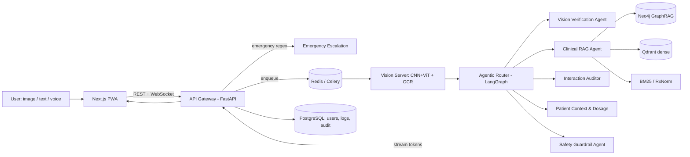
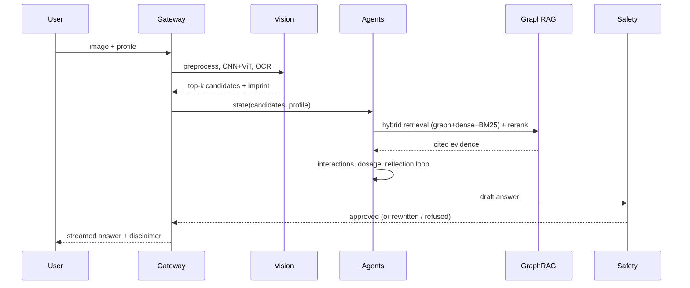

# PharmAi Vision — Master Blueprint & Free Web App

**Designed & developed by NIKHIL CHARY SRIRAMOJU** · [GitHub](https://github.com/Nikhil-creat) · [LinkedIn](https://in.linkedin.com/in/nikhil-chary-sriramoju-95041b38a)

> Educational information only. Not a substitute for a pharmacist/physician. Never use for dosing decisions without professional verification.

## 1. Architecture





## 2. Layout
| Path | Purpose |
|---|---|
| `services/vision/` | CNN+ViT model, preprocessing, OCR, FastAPI server, ONNX export |
| `services/agents/` | LangGraph multi-agent graph |
| `services/api/` | Gateway: REST, WebSocket streaming, emergency escalation |
| `graph/` | Neo4j schema + hybrid retrieval/rerank |
| `db/schema.sql` | PostgreSQL schema |
| `guardrails/` | NeMo Guardrails config + emergency logic |
| `docker-compose.yml`, `infra/` | Orchestration + observability |

## 3. Run
```bash
cp .env.example .env   # set GROQ/OPENAI key, NEO4J_PASSWORD, PG_PASSWORD, PHI_KEK
docker compose up --build
```

## 4. Data sources (ingestion order)
RxNorm (identity spine) → DailyMed SPL (labels, imprint/shape/color) → openFDA (NDC, adverse events) → DrugBank/PubChem (mechanism, structures; check licence) → WHO EML (essential flags) → FDA flush list. Chunk labels by SPL section (LOINC codes), keep `rxcui` + section + URL on every chunk for citations.

## 5. HIPAA / GDPR design guidelines
- **Minimise PHI**: process images in memory; store only hashed image digest + derived features unless user opts in to history.
- **Encryption**: TLS 1.3 everywhere, mTLS between services; AES-256-GCM field-level encryption for PHI columns using envelope encryption (per-user DEK wrapped by KMS/HSM KEK, see `db/schema.sql`); encrypted volumes.
- **Access control**: RBAC + row-level security in Postgres; short-lived JWTs; MFA for clinician roles.
- **Audit**: append-only, hash-chained `agent_audit` table (who/what/when, model versions, evidence IDs). Retain per policy (HIPAA 6 yrs).
- **GDPR**: lawful basis + explicit consent for health data (Art. 9), export/erasure endpoints (crypto-shredding: delete DEK), DPIA, EU data residency, DPA with LLM vendors; no PHI to third-party LLMs without BAA — prefer self-hosted vLLM.
- **LLM hygiene**: redact identifiers before prompts; no PHI in logs/traces (OTel attribute scrubbing).
- **Regulatory note**: if marketed as clinical decision support/identification aid, assess FDA SaMD / EU MDR classification early.

## 6. Roadmap hardening
Fine-tune on NIH NLM Pill Image (C3PI) + synthetic augmentation; calibrate confidence (temperature scaling); red-team eval set for hallucinated dosing; offline ONNX/INT8 build for mobile via `export_onnx.py`; K8s HPA on queue depth.
